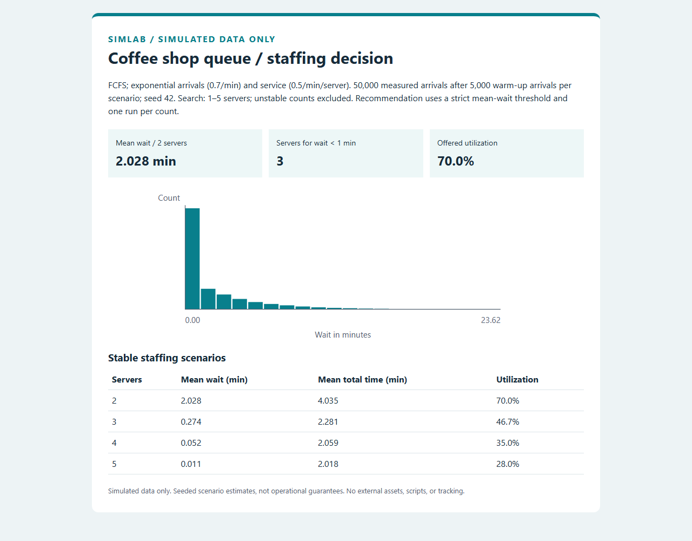
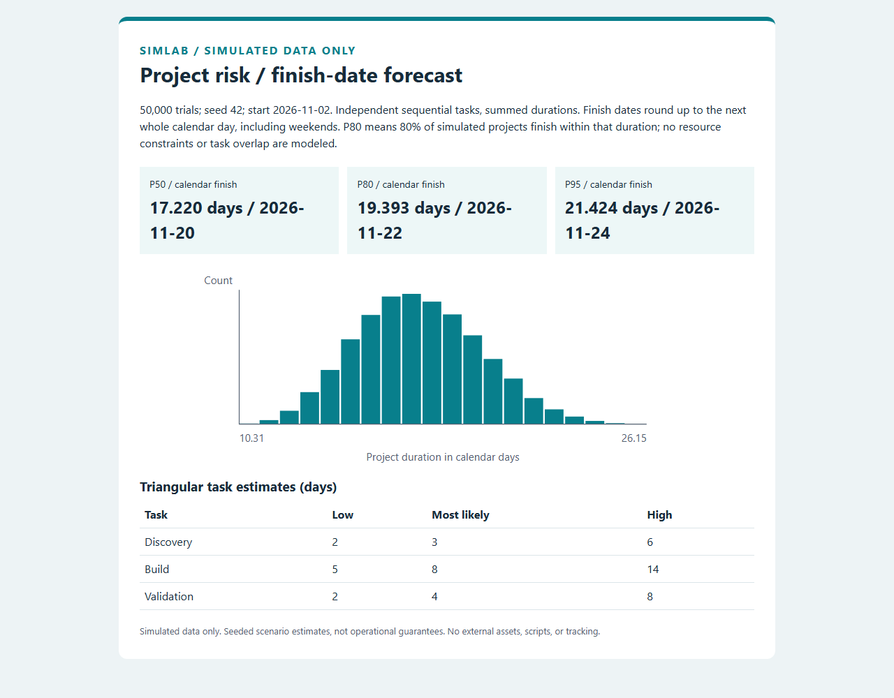

# Simlab

Two small simulation models that turn assumptions into a staffing decision or a
project finish-date forecast. Python 3.12+; standard library only at runtime.
**Simulated data only.** All examples are generic and contain no client data.

## Coffee shop queue: how many servers?

The discrete-event model uses a first-come, first-served M/M/c queue: independent
exponential interarrival and service times, identical servers, and an unlimited
waiting room. Rates are per minute; service rate is **per server**. It discards
warm-up arrivals before measuring waits and total time in the system.

```console
python -m simlab.cli queue --config examples/queue.json --out out/queue
```

The example has 0.7 arrivals/minute, 0.5 services/minute/server, seed 42,
50,000 measured customers and 5,000 warm-up arrivals per scenario. It compares
1–5 servers and selects the smallest stable count with mean wait strictly below
1 minute. The configured 2-server queue has **2.028 minutes mean wait** and
70.0% offered utilization. The recommendation is **3 servers**, with
**0.274 minutes mean wait**. One server is unstable and excluded.

| Servers | Mean wait (min) | Mean total time (min) | Offered utilization |
| --- | ---: | ---: | ---: |
| 2 | 2.028 | 4.035 | 70.0% |
| 3 | 0.274 | 2.281 | 46.7% |
| 4 | 0.052 | 2.059 | 35.0% |
| 5 | 0.011 | 2.018 | 28.0% |

Outputs: `out/queue/queue.html` (one-page report and wait histogram) and
`out/queue/queue.csv` (one row per stable staffing scenario, unrounded values).
Open the [saved queue report](docs/queue-report.html) in a browser.

## Project risk: when will it finish?

The Monte Carlo model sums independent triangular task durations. Each task has
a low, most likely (`mode`), and high duration in calendar days. Tasks run
sequentially; there are no overlaps, resource constraints, or correlations.

```console
python -m simlab.cli risk --config examples/risk.json --out out/risk
```

The example uses Discovery (2/3/6 days), Build (5/8/14), and Validation (2/4/8),
50,000 trials, seed 42, and a start date of 2026-11-02.

| Percentile | Duration (days) | Calendar finish |
| --- | ---: | --- |
| P50 | 17.220 | 2026-11-20 |
| P80 | 19.393 | 2026-11-22 |
| P95 | 21.424 | 2026-11-24 |

P80 means 80% of simulated projects finish within that duration. Quantiles use
linear interpolation between sorted samples; calendar finishes round durations
up to whole days and include weekends. Outputs: `out/risk/risk.html` and
`out/risk/risk.csv` (percentile, unrounded duration, finish date).
Open the [saved risk report](docs/risk-report.html) in a browser.

Both reports are self-contained HTML with inline SVG charts, no JavaScript or
external assets.





## Configure and validate

Edit the JSON examples; YAML is not required. Queue options are `arrival_rate`,
`service_rate`, `servers`, `customers`, `warmup`, `seed`, `target_wait_minutes`,
and `max_servers`. Risk options are `tasks`, `trials`, `seed`, and `start_date`;
each task needs a unique `name`, `low`, `mode`, and `high`.
Rates must be finite and positive; durations and the wait target are finite and
nonnegative. Counts are integers (positive except warm-up and seed, which may
be zero). A configured queue must satisfy arrival rate < servers × service rate.
`max_servers` must be at least `servers`. Bad JSON, invalid configs and file
errors produce a message on stderr and exit code 2. Successful runs exit 0.

The same config and seed reproduce the same numbers on the same Python
version; each run owns its RNG. Recommendations use one seeded estimate per
count and do not include confidence intervals. Increase run length and test
several seeds before using a result to inform a real decision. Infinite queue
capacity, exponential queue timings, independent tasks and calendar-day
estimates may differ from an actual operation.

## Development

Run from the repository root; an install is optional for the examples.

```console
python -m pip install -e ".[dev]"
python -m unittest discover -s tests
python -m ruff check .
```

The 25 tests cover reproducibility, validation and CLI exit codes, report
contents, and analytical reference cases. Fixed-seed million-customer runs
after 20,000 warm-up arrivals give M/M/1 mean wait 2.336836251 versus
2.333333333 (0.150125% error) at utilization 0.7, and M/M/3 mean wait
0.547749762 versus 0.547049442 (0.128018% error) at utilization 0.7;
both are within 5%. Risk checks compare a one-task sample against triangular
quantiles and an exactly hand-computed two-task constant-duration project.
CI runs Ruff and unittest on Ubuntu and Windows with Python 3.12 and 3.14.
